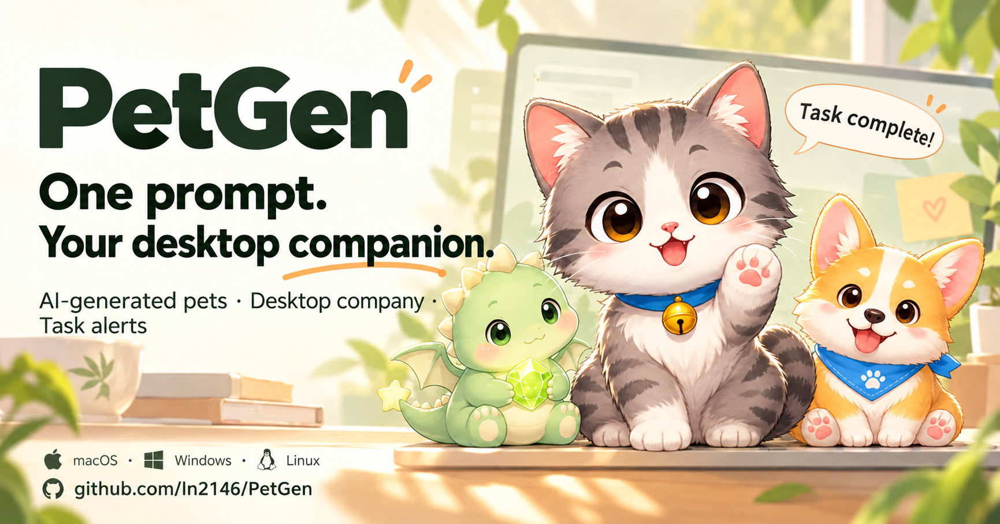

<p align="center">
  
</p>

<h1 align="center">PetGen · AI Desktop Pet Generator</h1>

<p align="center">
  Turn a prompt or reference image into your desktop companion.
</p>

<p align="center">
  <a href="README.md">Chinese</a> · <a href="README_EN.md"><b>English</b></a>
</p>

<p align="center">
  <a href="LICENSE"></a>
  
  <a href="https://github.com/ln2146/PetGen/releases"></a>
</p>

**PetGen is an AI desktop pet generator that turns your ideas into a companion living on your desktop.** Adopt a built-in pet right away, or create your own from a prompt or reference image. Configure an AI API key when you want to generate a new pet.

Your pet breathes, changes expressions, and speaks through bubbles. It can remind you to take breaks and keep you company during Pomodoro sessions. Connect Claude Code, Codex, or Antigravity, and your pet will let you know when an AI coding task finishes.

## Video introduction

A 15-second introduction to PetGen.

https://github.com/user-attachments/assets/b0ba97eb-a524-4d05-9ca7-bc5ebebcc37d

<p align="center">
  
  <br>
  <sub>Desktop notifications, break reminders, pet center, reminders, Pomodoro timer and daily usage.</sub>
</p>

<p align="center">
  
  <br>
  <sub>A preview of the grey-white cat in motion.</sub>
</p>

## Featured Pets

Each pet is generated from one sentence, shares a consistent style, and can be used directly in the desktop app.

<p align="center">
  <table align="center">
    <tr>
      <td align="center"></td>
      <td align="center"></td>
      <td align="center"></td>
      <td align="center"></td>
      <td align="center"></td>
      <td align="center"></td>
    </tr>
    <tr>
      <td align="center"><sub><b>Grey-white Cat</b></sub></td>
      <td align="center"><sub><b>Panda Buddy</b></sub></td>
      <td align="center"><sub><b>Arctic Fox</b></sub></td>
      <td align="center"><sub><b>Ginger Kitten</b></sub></td>
      <td align="center"><sub><b>Mint Baby Dragon</b></sub></td>
      <td align="center"><sub><b>Corgi Pup</b></sub></td>
    </tr>
  </table>
</p>

## Features

| Feature | Description |
|---------|-------------|
| AI pet generation | Create a pet from a prompt or reference image and automatically prepare its animation assets |
| Desktop companionship | A pet that stays on your desktop with breathing animations, speech bubbles and changing expressions |
| Pet center | Browse, switch, import and manage your companions |
| Break reminders | Get a gentle nudge to move after a stretch of computer use |
| Pomodoro timer | Focus for 25 minutes and let your pet remind you when the session ends |
| Daily usage | View your current work session, daily total and reminder count |
| AI task feedback | Receive pet notifications when Claude Code, Codex or Antigravity tasks finish |

## Download

To try PetGen without setting up a development environment, download an application package from [Releases](https://github.com/ln2146/PetGen/releases).

Launch the app and use the tray menu to open the pet center, reminders, Pomodoro timer and usage panel. You can start with a built-in pet and configure an AI API key later if you want to generate your own.

## Quick Start

```bash
python3 -m venv .venv
source .venv/bin/activate
pip install -e ".[desktop]"
petgen app
```

To generate a new pet, first copy `.env.example` to `.env` and configure your API key as described below. Then run:

```bash
petgen generate \
  --prompt "a chubby capybara programmer wearing tiny headphones, gentle and smart" \
  --name "Capybara Coder" \
  --output outputs/capybara-coder
```

## Configuration

The project automatically loads `.env` from the current directory. The default provider is OpenAI:

```bash
OPENAI_API_KEY=sk-...
OPENAI_BASE_URL=https://api.openai.com/v1
OPENAI_IMAGE_MODEL=gpt-image-2
OPENAI_TEXT_MODEL=gpt-4o-mini
```

OpenAI-compatible providers are also supported:

```bash
OPENAI_BASE_URL=https://your-compatible-endpoint/v1
OPENAI_API_KEY=your-provider-key
OPENAI_IMAGE_MODEL=gpt-image-2
OPENAI_TEXT_MODEL=your-chat-model
```

## Common Commands

Generate from text:

```bash
petgen generate \
  --prompt "a chubby capybara programmer wearing tiny headphones, gentle and smart" \
  --name "Capybara Coder" \
  --output outputs/capybara-coder
```

Generate from a reference image:

```bash
petgen generate \
  --image /path/to/reference.png \
  --prompt "keep the colors and signature accessories, then turn it into a cute desktop pet" \
  --output outputs/from-reference
```

Build assets from an existing source sheet:

```bash
petgen build --source /path/to/source.png --name "Local Pet" --output outputs/local-pet
```

Run one existing pet directly:

```bash
petgen desktop outputs/capybara-coder --scale 1.5
```

## Generation Output

The output directory contains:

- `source.png`: raw model output, written by `generate` only.
- `sprite.png`: standard `8 x 9` pet spritesheet with transparency.
- `pet.json`: animation manifest and generation metadata.
- `preview.png`: first-frame preview.

<p align="center">
  
  <br><sub>Packed <code>8 x 9</code> spritesheet</sub>
</p>

## Desktop App

```bash
petgen app
```

`petgen app` starts the tray icon, floating pet, pet center, settings panel, and AI event bus. Runtime data is stored in `~/.petgen/` by default, and can be changed with `$PETGEN_DATA_DIR` or `--data-dir`.

Common entry points:

- Pet center: browse, select, preview, rename, delete, import, or create pets.
- Settings center: configure API credentials, models, animation, sound, voice packs, interaction styles, and tool integrations.
- Quick reminders: supports natural-language entries such as "tomorrow 3pm meeting" or "in 1 hour take medicine".
- Pomodoro timer: includes a 25/5 focus timer with pet reminders.

## AI Tool Integration

The pet can read AI coding events and switch expressions accordingly. In the app:

```text
petgen app -> Settings Center -> Tool Integration
```

Equivalent CLI commands:

```bash
petgen tools status all
petgen tools connect all
petgen tools disconnect all
petgen event KIND TITLE [DETAIL] [SOURCE]
```

See [docs/integrations.md](docs/integrations.md) for hook details, migration notes, and the manual event protocol.

## Source Image Spec

For stable local slicing, generated source images should follow these constraints:

- One image with a pure `#00FF00` green-screen background.
- Three action rows: row 1 has 6 idle frames, row 2 has 4 attentive frames, row 3 has 5 happy frames.
- Each frame should show the full body, centered, with visible green gaps between frames.
- The character body should not be mostly green, because same-color foreground and background cannot be separated reliably with color keying alone.

## Development

```bash
pip install -e ".[dev,desktop]"
pytest
ruff check .
python -m pip wheel . --no-deps -w /tmp/petgen-wheel
```

## Documentation

- [Development Guide](docs/development.md): setup, tests, linting, wheel builds, and release checks.
- [Tool Integrations](docs/integrations.md): Claude Code, Codex, and Antigravity integration notes.
- [Architecture](docs/architecture.md): generation pipeline, runtime components, storage, and error boundaries.
- [Troubleshooting](docs/troubleshooting.md): API, PySide6, sound, reminders, and slicing issues.

## Tech Stack

`Python >= 3.10` · `PySide6` · `Pillow` · `numpy` · `requests` · `edge-tts` · `pytest` · `ruff`

## Contributing

Issues and pull requests are welcome. Before submitting changes, run:

```bash
pytest
ruff check .
```

## License

[MIT](LICENSE)
